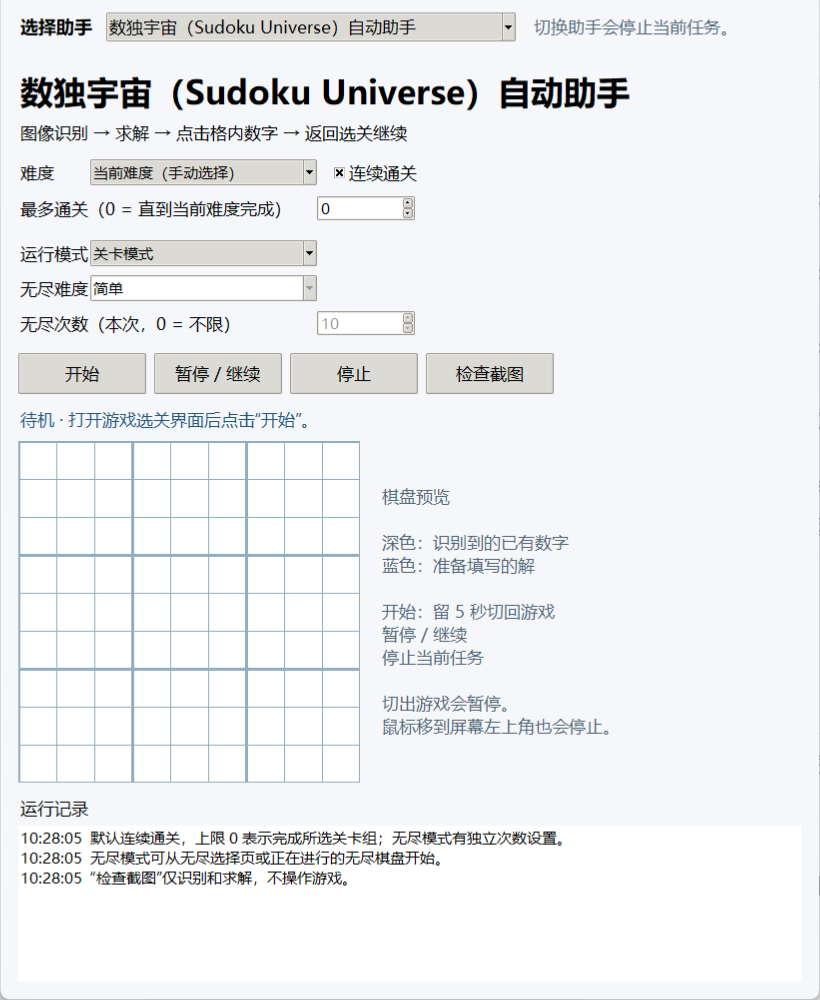

# SudokuAssistant

为数独宇宙、拼图数独和杀手数独提供棋盘识别、唯一解求解、自动填数和连续通关。打开一个程序，通过下拉栏选择对应游戏的助手即可使用。

## 支持的游戏

| 游戏 | 助手功能 |
|---|---|
| [数独宇宙（Sudoku Universe）](https://store.steampowered.com/app/733070/Sudoku_Universe/) | 普通数独求解、七组固定关卡、无尽模式 |
| [拼图数独（Sudoku Jigsaw）](https://store.steampowered.com/app/858040/Sudoku_Jigsaw/) | 异形宫识别、数独求解、三档难度连续通关 |
| [杀手数独（Sudoku Killer）](https://store.steampowered.com/app/861270/Sudoku_Killer/) | 虚线框和总和角标识别、求和约束求解、三档难度连续通关 |



## 开始使用

使用 64 位 Windows，先安装并打开对应游戏。

1. 从[发行版页面](https://github.com/DeianHsu/SudokuAssistant/releases/latest)下载 `SudokuAssistant.exe`，放入单独的文件夹后双击运行。无需安装 Python。
2. 在顶部“选择助手”下拉栏中选择正在玩的游戏。
3. 设置难度和通关数量。默认勾选“连续通关”，“最多通关”为 `0`，表示完成所选关卡组。
4. 点击“开始”，在 **5 秒内切回游戏**。

游戏应显示完整的 **16:9** 画面，建议使用 **2560×1440 全屏**。开始前关闭暂停、设置等弹窗。

从已有棋盘继续时，选择“当前难度（手动选择）”。需要自动选择难度时，从游戏选关界面开始。

## 操作说明

| 操作 | 作用 |
|---|---|
| 开始 | 倒计时 5 秒后读取对应游戏的画面，求解并自动填写 |
| 暂停 / 继续 | 暂停任务；继续时留出 5 秒切回游戏，然后重新读取棋盘 |
| 停止 | 结束当前任务并松开鼠标 |
| 切换助手 | 立即停止当前任务，显示新助手的界面；点击“开始”后才运行新任务 |
| 检查截图 | 选择游戏截图，仅识别和求解，并显示棋盘预览 |

切出游戏会自动暂停。继续时，点击“暂停 / 继续”，再在 5 秒内切回游戏。鼠标移动到屏幕左上角可以紧急停止。

切换助手会保留各界面的设置、预览和运行记录。操作通过界面按钮完成，填数点击节拍固定为 **20 毫秒**。

## 连续通关与无尽模式

- 勾选“连续通关”后，会进入下一未完成关卡；取消勾选则只完成一盘。
- “最多通关”设为正整数时，完成对应盘数后停止；设为 `0` 时，运行至所选关卡组完成。
- 拼图数独和杀手数独可选择简单、中等、困难，或“依次完成三个难度”。
- 数独宇宙可选择七组固定关卡，或“依次完成全部七组”。
- 数独宇宙的“无尽模式”有独立的难度和次数设置，默认 10 盘；次数为 `0` 时持续运行，直至停止。

助手会重新识别已经填入的数字，只填写剩余空格。识别并确认唯一解后，按答案连续点击；填完后等待通关结果，再进入下一盘。

## 遇到问题

**显示游戏不在前台**：确认所选助手与游戏对应。点击“暂停 / 继续”，在 5 秒内切回游戏，并保持游戏在前台。

**无法识别棋盘或角标**：确认画面完整、比例为 16:9，关闭游戏内弹窗。可以用“检查截图”查看截图是否能够识别。

**存在漏填或没有进入下一关**：停止任务后重新开始，助手会读取已填数字并补齐空格。确认“连续通关”已勾选，通关数量没有达到上限。

运行日志和诊断截图保存在程序旁的 `data` 目录，各游戏使用独立的子目录：

| 游戏 | 记录目录 |
|---|---|
| 数独宇宙 | `data/universe/` |
| 拼图数独 | `data/jigsaw/` |
| 杀手数独 | `data/killer/` |

`运行记录.txt` 保存运行日志；发生识别或操作错误时，`last_game.png` 保存最后画面。反馈问题时，请提供游戏名称、画面分辨率、操作步骤及相关日志或截图。

## 从源码运行

安装 Python 3.12，在项目根目录打开 PowerShell：

```powershell
python -m venv .venv
.\.venv\Scripts\python.exe -m pip install -r requirements.txt
.\.venv\Scripts\python.exe src/app.py
```

在 Windows 上生成可执行程序：

```powershell
powershell -ExecutionPolicy Bypass -File .\src\build.ps1 -Python .\.venv\Scripts\python.exe
```

打包结果保存为 `app/SudokuAssistant.exe`。

## 目录结构

```text
SudokuAssistant/
├── README.md          使用说明
├── app/               可直接运行的程序
├── assets/            界面图片
├── src/               源码、识别资源和测试样本
└── requirements.txt   Python 依赖配置
```
